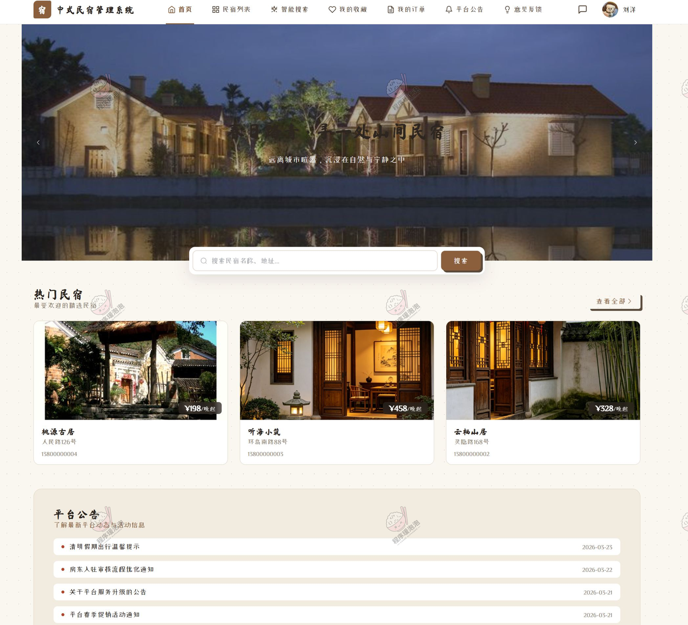
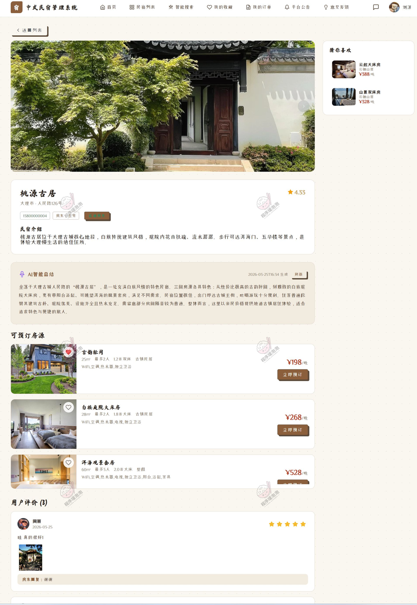
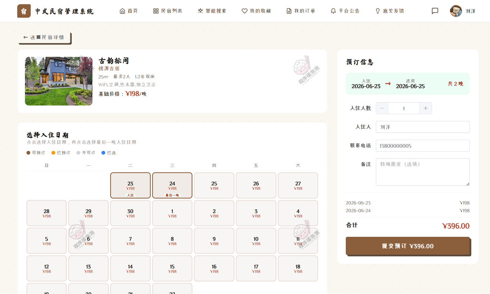
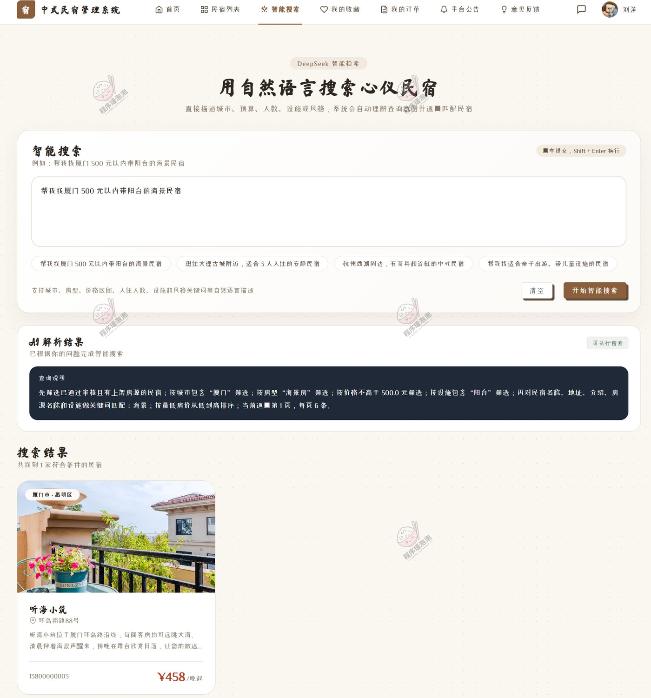
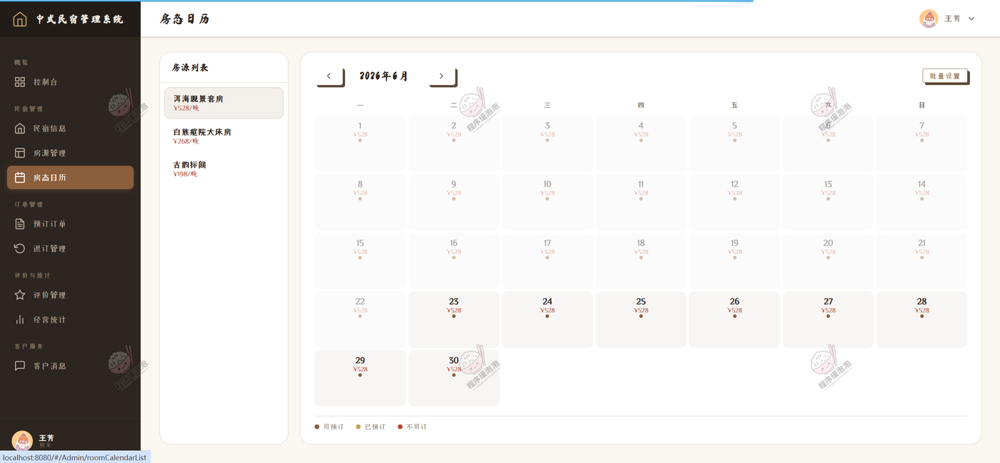
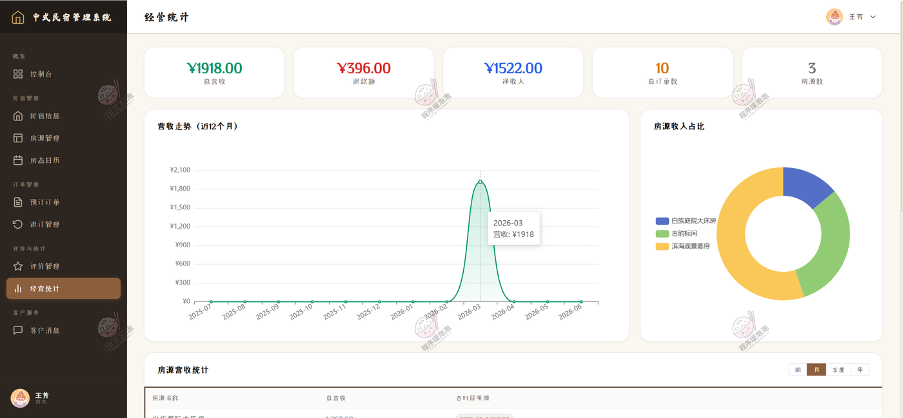
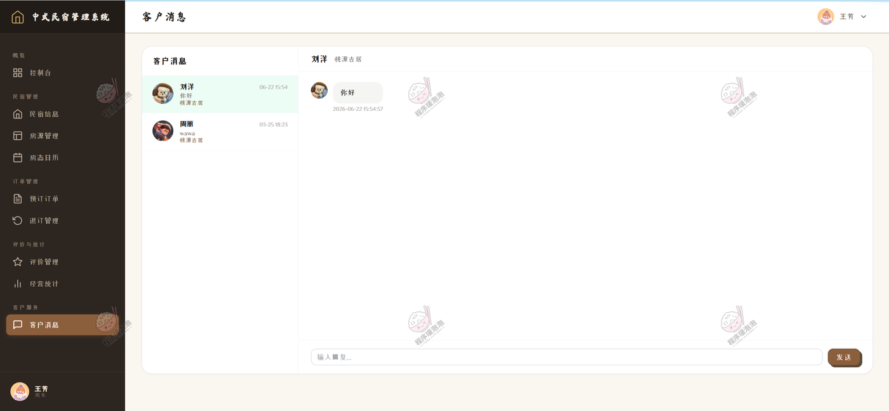
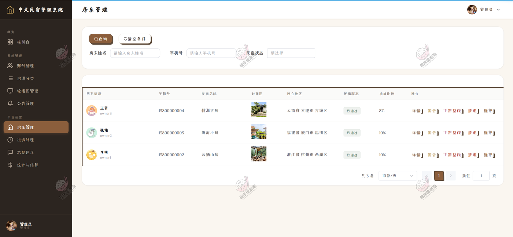
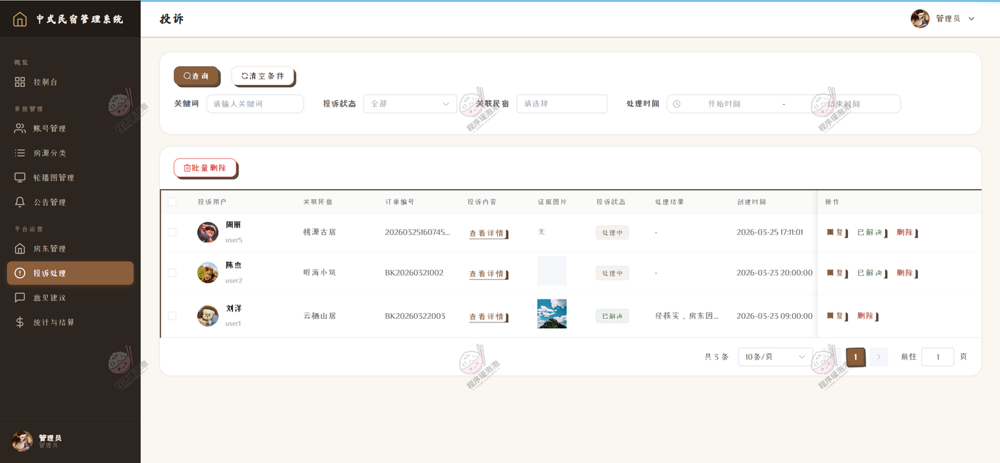
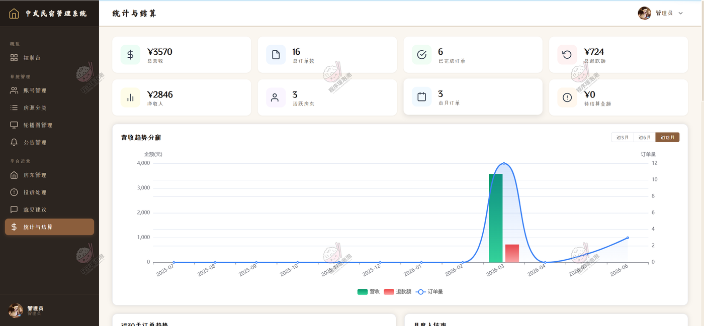

# ChineseStyleHomestayManagementSystem
中式民宿管理系统  民宿管理系统 

所有源码均本人开发，项目是前后端分离的，所有的项目都具备了完整的业务逻辑，不仅仅局限于基础的增删改查（CRUD）操作，系统亮点众多。

本文注重于计算机毕业设计选题指导，列出题目均有源码， 大家可以去【公众号】(毕业终点站)获取或者加我【qq】(2112698948)提意见(别忘记Star哟)。备注：git

声明：仅用于学习使用，请勿用于任何商业行为！

1.系统非商用，非开源，非无偿。

2.由本人开发，如需源码，请联系以下方式，qq:2112698948。资料网站： https://home.biyecode.com；

3.项目有很多，并未全部上传，如果未找到想要的，可直接咨询。

# 中式民宿管理系统

基于住客网页前台 + 民宿房东后台 + 平台管理后台的中式民宿预订系统，把智能找房、AI 总结、在线预订、房态维护和经营结算放在一处。三类角色各司其职：住客描述需求找房并完成预订评价，房东维护房源房态并处理订单，平台负责入驻审核、投诉处理和营收结算。

## 项目简介

- **架构**：B/S、MVC、前后端分离，住客前台 + 房东后台 + 平台管理后台，多角色管理
- **开发环境**：IDEA、JDK17、Maven、MySQL、Node.js
- **后端技术**：Java、Spring Boot 3.3.1、Spring MVC、MyBatis-Plus、MySQL、JWT、WebSocket、Apache POI
- **前端技术**：Vue 3、Vite、Element Plus、Vue Router、Pinia、Axios、ECharts、Sass
- **智能服务**：DeepSeek API、自然语言搜索意图解析、民宿 AI 总结、基于预订行为的协同过滤推荐

## 系统亮点

- **DeepSeek 自然语言智能搜索**：住客直接描述找房需求，系统解析为结构化查询条件（城市、房型、价格区间、入住人数、设施风格），结合数据库筛选民宿并分页展示，让找房从填写筛选项延伸到直接说需求。
- **民宿 AI 总结**：结合民宿资料、房源与评价信息生成推荐总结，帮助住客快速了解住宿特色，支持总结缓存与手动刷新（AI 功能需配置有效的 DeepSeek API 服务）。
- **协同过滤房源推荐**：根据预订过同一民宿的用户的其他预订行为寻找关联房源，按预订次数排序推荐，无关联数据时用热门房源兜底，在民宿详情的"猜你喜欢"处展示。
- **WebSocket 在线咨询**：聊天消息经接口保存并实时推送给对方，配合会话列表与历史记录，让住客和房东围绕入住需求持续沟通。
- **房态日历与预订联动**：房东按日期维护房态和价格，住客按入住区间查询并提交预订，支付演示完成后更新对应日期房态，把房源维护与订单处理串成一条线。
- **三角色住宿业务流程**：平台负责入驻审核与运营管理，房东负责房源、订单、退订及评价回复，住客完成找房、预订、入住评价与售后申请。
- **ECharts 经营分析与结算**：平台和房东分别查看经营数据，用图表呈现营收、订单及入住情况，并结合结算比例计算平台抽成和房东应结金额。
- **投诉与建议反馈**：住客提交投诉和建议，平台处理并回复，住客可查看处理进度，方便跟进住宿服务问题。

## 系统功能

### 住客网页前台

- 账号注册登录、个人资料维护与密码修改
- 首页与公告浏览、民宿搜索筛选、民宿与房源详情
- DeepSeek 自然语言智能搜索、民宿 AI 总结、推荐房源浏览
- 收藏与预订、房态查询、订单与支付演示
- 入住评价与退订、投诉与建议反馈、房东在线咨询

### 民宿房东端

- 注册与入驻申请、民宿信息与房源信息维护
- 房态日历管理（按日期批量设置房态与价格）
- 预订订单处理、退订审核与评价回复
- 经营数据查看（营收、入住率、结算记录）
- 在线咨询管理

### 平台管理员端

- 平台数据看板、房东入驻审核与管理
- 用户与房源管理、订单与评价管理
- 统计与结算管理（平台抽成、房东应结）
- 投诉与建议处理、轮播图与公告管理

## 系统截图

> 顶部为住客首页总览。截图按住客、房东、管理员三个角色依次展示。源文档首图为登录入口页，未提供独立的系统总览图，故以住客首页作为总览展示。

### 一、住客网页前台

**首页与热门民宿**

首页以中式民宿主题轮播开场，展示热门民宿卡片（名称、地区、评分、价格）与平台公告，顶部导航串联找房、收藏、订单与反馈入口。

**民宿详情与 AI 总结**

详情页展示民宿实拍、评分、介绍与可预订房源列表，内嵌"AI 智能总结"板块概括住宿特色，右侧"猜你喜欢"为协同过滤关联推荐，下方为用户评价。

**立即预订与房态日历**

选择入住/离店日期后在房态日历上标注可预订、已预订、不可订与已选状态，结合入住人数与联系信息生成合计金额并提交预订。

**DeepSeek 智能搜索**

输入自然语言描述（如"帮我找厦门 500 元以内带阳台的海景民宿"），系统给出 AI 解析后的查询条件与匹配民宿结果，也提供常见需求的快捷示例。

### 二、民宿房东端

**房态日历管理**

按房源查看月度日历，逐日设置房态与价格并支持批量设置，图例区分可预订、已预订与不可订，与住客端预订展示保持联动。

**经营统计与结算**

房东工作台展示总营收、退款额、净收入、订单数与房源数，配合营收走势折线和房源收入占比环形图查看经营情况。

**客户消息（在线咨询）**

会话列表展示咨询用户与时间，聊天区收发消息并保留历史记录，通过 WebSocket 与住客实时沟通入住需求。

### 三、平台管理员端

**房东入驻管理**

按姓名、手机号、入驻状态筛选房东，列表展示民宿、所在地、入驻审核状态与抽成比例，支持详情、警告、下架整改、清退与维护。

**投诉处理**

按状态、关联民宿、处理时间筛选投诉，列表展示投诉用户、内容、证据图片与处理结果，支持查看/已解决/删除操作，对应住客端"我的投诉"进度查看。

**统计与结算**

汇总总营收、总订单数、净收入、佣金与已结算金额，通过营收趋势分析图（营收、退款额、订单量）掌握平台经营数据并核算结算。

---

文档展示 10 张截图，需要了解更多，请联系我。

# 四.源码获取
1.原创系统非商用，非开源，非无偿。

2.项目有很多，并未全部上传，如果未找到想要的，可直接咨询。

